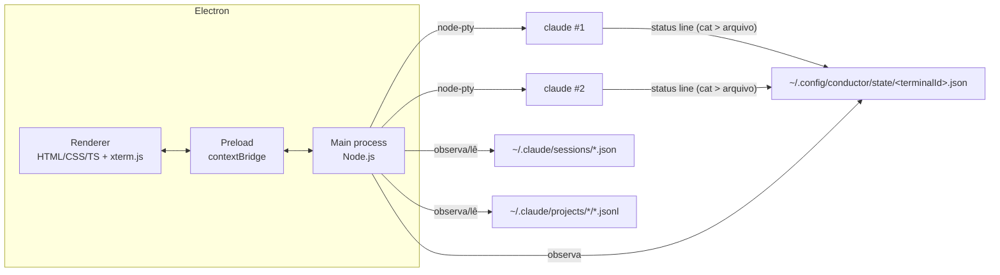

# Arquitetura

Estado ao fim da fase 6. As decisões citadas (D-xxx) estão em [decisoes.md](decisoes.md).

## Visão geral



O app nunca chama a API da Anthropic: cada terminal roda o binário `claude` oficial num pseudo-terminal (D-001, D-003). Os arquivos do Claude são só lidos (D-004).

## Processos e módulos

### Main (`src/main/`)

| Módulo | Responsabilidade |
|---|---|
| `index.ts` | Janela, menu (removido, D-014), permissões do Chromium, canais IPC, ciclo de vida, ganchos de teste (`CONDUCTOR_CAPTURE`, `CONDUCTOR_E2E`) |
| `pty-manager.ts` | Cria, redimensiona, escreve e encerra os ptys (SIGHUP). Agrupa a saída por tick antes do IPC. Guarda `terminalId → sessionId` (atualizado no `/clear`) |
| `claude-bin.ts` | Localiza o binário `claude` (PATH e fallbacks) e monta o ambiente do processo filho (D-015) |
| `claude-launch.ts` | Valida diretório e nome; monta os argumentos (`--session-id`/`--name` ou `--resume`, e `--settings`) |
| `statusline.ts` | Monta o comando da status line (D-005), observa `~/.config/conductor/state/` e interpreta os payloads |
| `session-hub.ts` | Junta histórico, registro, status line e terminais do app; publica histórico, status/contexto e uso; persiste o último uso |
| `attention.ts` | Notificação do sistema + piscar a janela quando um terminal fica "precisa de você" fora de foco (D-017) |
| `claude-data/registry.ts` | Lê e observa `~/.claude/sessions/` (só processos vivos) |
| `claude-data/history.ts` | Indexa `~/.claude/projects/` lendo só início e fim de cada `.jsonl`, com cache |
| `claude-data/paths.ts`, `types.ts` | Caminhos (respeita `CLAUDE_CONFIG_DIR`) e tipos dos formatos internos |

### Preload (`src/preload/index.ts`)
Expõe `window.conductor` (tipo `ConductorApi`) com funções específicas, nunca o `ipcRenderer` inteiro.

### Renderer (`src/renderer/`)

| Módulo | Responsabilidade |
|---|---|
| `src/main.ts` | Estado (terminais abertos, histórico, busca) e ligação entre as partes |
| `src/xterm-session.ts` | Um xterm.js ligado a um pty: tema, fontes, WebGL, `Ctrl+Shift+C/V`, ajuste de tamanho |
| `src/sidebar.ts` | Terminais ativos (ordenados por contexto) e histórico |
| `src/terminal-view.ts` | Cabeçalho, barras e estado vazio do painel direito |
| `src/usage-footer.ts` | Rodapé: Sessão (5h), Semanal e resumo dos terminais (D-006) |
| `src/new-terminal-dialog.ts` | Diálogo "Novo terminal" (diretório, recentes, nome) |
| `src/dialogs.ts`, `toast.ts` | Confirmação reutilizável e aviso flutuante |
| `src/shortcuts.ts` | Atalhos do app, capturados antes do xterm (D-007) |
| `src/recent-dirs.ts` | Diretórios recentes (localStorage, só conveniência) |
| `src/format.ts`, `dom.ts` | Formatação (tokens, datas) e helper `el()` sem `innerHTML` |

### Compartilhado (`src/shared/ipc.ts`)
Nomes dos canais e tipos do contrato entre os três processos. É a fonte de verdade do IPC.

## Contrato IPC

Renderer → Main:

| Canal | Tipo | Payload → Retorno |
|---|---|---|
| `app:info` | invoke | → `AppInfo` (versões, `homeDir`) |
| `terminal:create` | invoke | `{ cwd?, name?, resumeSessionId?, cols, rows }` → `{ ok, terminalId, sessionId, cwd, name }` ou `{ ok: false, error }` |
| `terminal:write` / `resize` / `kill` | send | `terminalId, …` |
| `terminal:name` | send | `terminalId, name` (para as notificações) |
| `history:get` | invoke | → `HistoryItem[]` |
| `usage:get` | invoke | → `UsageSnapshot \| null` |
| `dialog:pick-directory` | invoke | `defaultPath?` → `string \| null` |
| `app:confirm-close` | send | — |

Main → Renderer (eventos):

| Canal | Payload |
|---|---|
| `terminal:data` / `terminal:exit` | `{ terminalId, data }` / `{ terminalId, exitCode, signal? }` |
| `session:update` | `SessionUpdate` parcial: `status`, `context`, `model`, `branch`, `name`, `sessionId` |
| `history:update` | `HistoryItem[]` completo |
| `usage:update` | `UsageSnapshot` |
| `terminal:focus` | `terminalId` (clique na notificação) |
| `app:close-requested` | — (D-011) |

Todo canal valida a origem (só a janela principal) e os tipos do payload no main.

## Ciclo de vida de um terminal

1. **Criar.** O diálogo envia `terminal:create`. O main valida o diretório, gera `terminalId` e `sessionId` e faz o spawn de
   `claude --session-id <uuid> --name <nome> --settings '{"statusLine":…}'`.
2. **Retomar.** O clique no histórico envia `resumeSessionId`. O main recusa se a sessão já estiver aberta no app ou fora dele (D-010) e faz o spawn de `claude --resume <id> --settings …` no `cwd` original.
3. **Rodar.** Saída do pty → `terminal:data` → xterm.js; teclado → `terminal:write`.
4. **Status.** O registro (`~/.claude/sessions/<pid>.json`) dá busy/idle/waiting. A status line dá contexto, modelo, nome e uso do plano. O `.jsonl` dá a branch. Tudo chega como `session:update`/`usage:update`.
5. **Fechar.** Depois da confirmação, SIGHUP. O `claude` sai (código 129) e a sessão volta ao histórico.

## Dados do próprio app (`~/.config/conductor/`)

O mesmo diretório em desenvolvimento e empacotado (`app.setPath('userData', …)` no main).

| Arquivo | Conteúdo |
|---|---|
| `state/<terminalId>.json` | Último payload da status line de cada terminal aberto (apagado ao fechar e ao iniciar o app) |
| `usage.json` | Último uso do plano conhecido (mostrado ao reabrir) |
| `Local Storage/` | Diretórios recentes |

## Empacotamento

- `npm run dist` → `electron-vite build` + `electron-builder --linux` → `dist/Conductor-<versão>.AppImage`.
- `node-pty` fica fora do `.asar` (`asarUnpack`), porque o `.node` nativo precisa estar no disco.
- `scripts/install-desktop.sh` copia o AppImage para `~/.local/opt/conductor/`, o ícone para `~/.local/share/icons/` e cria `~/.local/share/applications/conductor.desktop` (`StartupWMClass=conductor`, igual ao `desktopName`).
- Aberto pelo menu, o PATH pode não ter `~/.local/bin`; por isso o fallback de caminhos da D-015.

## Estrutura de pastas

```
terminal-orchestrator/
├── index.html               # mockup original (referência, não alterar)
├── README.md                # início rápido
├── docs/
├── build/icon.png           # ícone (gerado por scripts/render-icon.cjs)
├── scripts/
│   ├── install-desktop.sh   # instala o AppImage + atalho no menu (--uninstall remove)
│   ├── render-icon.cjs
│   └── e2e/fase-{2..5}.cjs  # roteiros de teste com prints
├── spikes/fase-0/           # validação técnica da fase 0
├── electron.vite.config.ts
├── tsconfig*.json
└── src/
    ├── shared/ipc.ts
    ├── main/
    │   ├── index.ts
    │   ├── pty-manager.ts
    │   ├── claude-bin.ts
    │   ├── claude-launch.ts
    │   ├── statusline.ts
    │   ├── session-hub.ts
    │   ├── attention.ts
    │   └── claude-data/{paths,types,registry,history}.ts
    ├── preload/index.ts
    └── renderer/
        ├── index.html
        ├── styles.css
        └── src/*.ts
```

## Desempenho

- Saída do pty agrupada por tick do event loop antes do IPC.
- Pastas observadas com `fs.watch` (inotify) e debounce, mais uma releitura do registro a cada 5 s para limpar processos que morreram sem apagar o arquivo.
- Histórico: só os trechos de 256 KB do início e do fim de cada `.jsonl`, com filtro de substring antes do `JSON.parse`. Medido: 24 sessões / 180 MB em ~94 ms na primeira varredura e ~1 ms depois.
- xterm.js com WebGL; sem GPU, cai no renderer DOM.
- Trocar de terminal só esconde o xterm (processo e scrollback continuam vivos).
