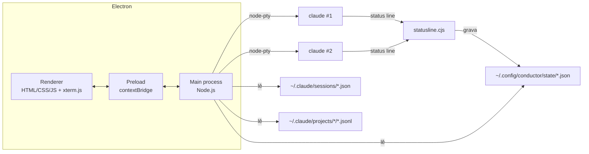

# Arquitetura

## Visão geral



## Processos

### Main process (`src/main/`)
É o único processo com acesso ao sistema.

| Módulo | Responsabilidade |
|---|---|
| `index.ts` | Cria a janela, registra os canais IPC e faz o ciclo de vida do app |
| `pty-manager.ts` | Cria, redimensiona, escreve e encerra os pseudo-terminais. Guarda o mapa `terminalId → { pty, sessionId, cwd, name }` |
| `claude-data/history.ts` | Varre `~/.claude/projects/` e monta a lista do histórico (título, cwd, data, branch) |
| `claude-data/registry.ts` | Lê e observa `~/.claude/sessions/` (só processos vivos) |
| `session-hub.ts` | Junta histórico, registro e terminais do app; publica histórico e status para o renderer |
| `usage.ts` | Observa `~/.config/conductor/state/` e consolida os limites 5h e semanal |
| `claude-bin.ts` | Localiza o binário `claude` e monta o ambiente do processo filho (D-015) |
| `claude-launch.ts` | Valida diretório e nome e monta os argumentos do `claude` (`--session-id`, `--name`, `--resume`) |
| `resources/statusline.cjs` | Script **executado pelo `claude`**, não pelo app (D-005) |

### Preload (`src/preload/index.ts`)
Expõe uma API mínima em `window.conductor`. O renderer não acessa Node diretamente.

### Renderer (`src/renderer/`)
É o layout do mockup, com os dados falsos trocados por eventos reais. Cada terminal tem uma instância de xterm.js. Ao trocar de terminal, a instância é **escondida, não destruída**, para preservar o scrollback e não reiniciar o processo.

## Contrato IPC (rascunho)

Renderer → Main (`invoke`):

| Canal | Payload | Retorno |
|---|---|---|
| `terminal:create` | `{ cwd, name }` | `{ terminalId, sessionId }` |
| `terminal:resume` | `{ sessionId, cwd }` | `{ terminalId }` |
| `terminal:write` | `{ terminalId, data }` | — |
| `terminal:resize` | `{ terminalId, cols, rows }` | — |
| `terminal:close` | `{ terminalId }` | — |
| `history:list` | `{ query? }` | `HistoryItem[]` |
| `dialog:pickDirectory` | — | `string \| null` |

Main → Renderer (eventos):

| Canal | Payload |
|---|---|
| `terminal:data` | `{ terminalId, data }` |
| `terminal:exit` | `{ terminalId, exitCode }` |
| `session:status` | `{ sessionId, status: 'busy' \| 'idle' \| 'attention' }` |
| `session:context` | `{ sessionId, usedTokens, windowSize, model, branch }` |
| `usage:update` | `{ fiveHour, sevenDay, sevenDayByModel?, readAt }` |
| `history:changed` | — |

## Ciclo de vida de um terminal

1. **Criar.** O renderer pede `terminal:create`. O main gera o UUID e faz o spawn de
   `claude --session-id <uuid> --name <nome> --settings <json-statusline>` no `cwd` escolhido.
2. **Rodar.** A saída do pty vai como `terminal:data` para o xterm.js. O teclado volta como `terminal:write`.
3. **Status.** `sessions.ts` vê o `<pid>.json` mudar e emite `session:status`.
4. **Fechar.** Depois do diálogo de confirmação, o main encerra o pty (SIGTERM e, após um tempo limite, SIGKILL). A sessão já está salva no `.jsonl` e aparece no histórico.
5. **Retomar.** Um clique no histórico dispara o spawn de `claude --resume <id> --settings ...` no `cwd` original da sessão.

## Estrutura de pastas (proposta)

```
terminal-orchestrator/
├── index.html              # mockup original (referência, não alterar)
├── docs/
├── package.json
├── electron.vite.config.ts
├── tsconfig.json
├── resources/
│   └── statusline.cjs      # executado pelo `claude` (D-005)
└── src/
    ├── shared/
    │   └── ipc.ts          # tipos do contrato IPC
    ├── main/
    │   ├── index.ts
    │   ├── pty-manager.ts
    │   ├── usage.ts
    │   ├── claude-bin.ts
    │   ├── claude-launch.ts
    │   └── claude-data/
    │       ├── types.ts    # tipos dos formatos internos do Claude
    │       ├── paths.ts
    │       ├── registry.ts
    │       └── history.ts
    ├── session-hub.ts
    ├── preload/
    │   └── index.ts
    └── renderer/
        ├── index.html
        ├── styles.css
        └── src/
            ├── main.ts          # estado e ligação entre as partes
            ├── xterm-session.ts # um xterm.js ligado a um pty (D-003, D-014)
            ├── new-terminal-dialog.ts
            ├── dialogs.ts       # confirmação reutilizável
            ├── shortcuts.ts     # atalhos do app, capturados antes do xterm (D-007)
            ├── recent-dirs.ts   # diretórios recentes (localStorage)
            ├── sidebar.ts       # terminais ativos + histórico
            ├── terminal-view.ts # painel direito (xterm.js na fase 2)
            ├── usage-footer.ts  # rodapé (D-006)
            ├── format.ts        # tokens, datas, rótulos de status
            ├── dom.ts           # helper el(), sem innerHTML
            ├── mock-data.ts     # dados falsos (some até a fase 5)
            └── env.d.ts         # tipo de window.conductor
```

O script em `resources/` é JavaScript puro (`.cjs`), porque roda como processo independente chamado pelo `claude`, fora do Electron. Precisa iniciar rápido e não pode depender do build.

## Desempenho

- Observar pastas com `fs.watch` e processar com debounce, em vez de ficar consultando em intervalos.
- Histórico: ler só o necessário de cada `.jsonl` (início para `cwd` e data, fim para título e uso). Nunca carregar arquivos grandes inteiros. Manter cache por `mtime`.
- xterm.js com o addon WebGL. Se a GPU não suportar, cair para o renderer padrão.
